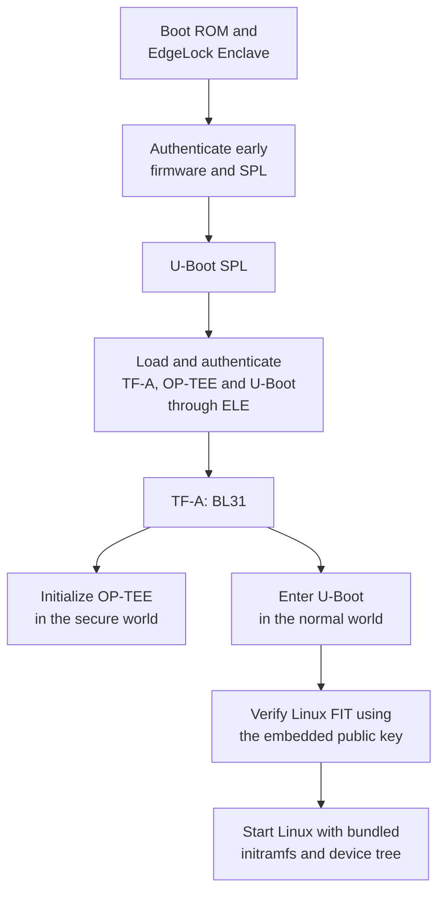

# meta-imx-secure

[](https://github.com/embetrix/meta-imx-secure/actions/workflows/container.yml?query=branch%3Awrynose)
[](https://github.com/embetrix/meta-imx-secure/actions/workflows/kas-parse.yml?query=branch%3Awrynose)
[](COPYING.MIT)

A Yocto layer that extends the NXP i.MX BSP with secure boot, encrypted and verified storage, IMA/EVM integrity checks and kernel and userspace hardening.

## Features

| Area | Capabilities |
| --- | --- |
| Boot security | AHAB boot image signing with NXP SPSDK, signed Linux FIT images and optional AHAB PQC signing on supported silicon |
| Storage | Encrypted read-only root filesystem, AVB metadata verification, dm-verity with forward error correction (FEC) and encrypted writable data |
| Key protection | OP-TEE-backed kernel encrypted keys plus EdgeLock Enclave cryptography and persistent key storage |
| Runtime protection | IMA/EVM integrity checks, signed kernel modules and kernel and userspace hardening |
| Access control | nftables firewall, OpenSSH CA authentication, USBGuard and audit logging |
| Cryptographic integration | OpenSSL integration through PKCS#11 using OP-TEE or NXP Security Middleware (SMW) |
| Build and integration | Development and production profiles, A/B boot and root filesystem layout, CVE scanning and SPDX SBOM generation |

These features support [Cyber Resilience Act (CRA)](https://digital-strategy.ec.europa.eu/en/policies/cra-manufacturers) readiness. Compliance depends on the finished product and its maintenance processes.

## Supported hardware

These boards are tested:

| Board | `MACHINE` | Tested by |
| --- | --- | --- |
| [FRDM-IMX95](https://www.nxp.com/design/design-center/development-boards-and-designs/FRDM-IMX95) | `imx95-15x15-lpddr4x-frdm` | [embetrix](https://github.com/embetrix) |
| [FRDM-IMX93](https://www.nxp.com/design/design-center/development-boards-and-designs/FRDM-IMX93) | `imx93-11x11-lpddr4x-frdm` | [embetrix](https://github.com/embetrix) |
| [FRDM-IMX91](https://www.nxp.com/design/design-center/development-boards-and-designs/FRDM-IMX91) | `imx91-11x11-lpddr4-frdm`  | [embetrix](https://github.com/embetrix) |

Other boards may need further adaptation. Submit patches or pull requests to add support for additional tested boards.

PQC support depends on the SoC, silicon revision and container format. See [NXP's i.MX95 B0 example](https://spsdk.readthedocs.io/en/latest/examples/ahab/imx95/imx95_ahab_sign.html) and the [layer signing options](classes-recipe/imx-boot-sign.bbclass). HABv4 signing is not implemented.

## Quick start

### 1. Prepare the host

Install `kas`, `openssl`, `ssh-keygen`, `bmaptool` and the host dependencies required by the Yocto release used in [kas-imx-secure.yml](kas-imx-secure.yml). Run the following commands from the layer directory.

Use a **16 GB or larger SD card** with the default partition sizes.

### 2. Generate signing keys

```sh
tools/generate-signing-keys.sh
```

The helper creates AHAB, FIT, kernel module, IMA/EVM, AVB and SSH CA keys under `imx-secure-keys/`. It generates `kas-signing-keys.yml` with the signing settings and absolute key paths. Existing keys are checked and reused.

Keep private keys secure and maintain an offline backup. Run the helper again if you move the checkout or key directory to update the generated paths.

### 3. Select the machine and profile

`KAS_MACHINE` selects the board. `SECURITY_PROFILE` is passed to BitBake as `IMX_SECURITY_PROFILE`.

| Profile | Intended use | Access and hardening |
| --- | --- | --- |
| `dev` (default) | Bring-up and debugging | Serial access, debug tools and password-free root login |
| `prod` | Product integration | Requires boot signing, applies kernel and userspace hardening, restricts the U-Boot console, disables the Linux serial console and serial getty and enables SSH CA authentication with password login disabled |

Both profiles include storage encryption, root filesystem verification and IMA/EVM. Use development images only on an isolated test network.

### 4. Build

Replace `<MACHINE>` with a machine name from [Supported hardware](#supported-hardware):

```sh
KAS_MACHINE="<MACHINE>" SECURITY_PROFILE=dev \
    kas build kas-imx-secure.yml:kas-signing-keys.yml
```

Use `SECURITY_PROFILE=prod` for a production-profile build. The default distro is `imx-secure` and the target is `imx-secure-image`.

Build output is written to `build/tmp/deploy/images/<MACHINE>/`. See [Build artifacts](#build-artifacts) for the generated files.

### 5. Flash and boot

Unmount the SD card partitions, then write the complete disk image:

```sh
sudo bmaptool copy \
    "build/tmp/deploy/images/<MACHINE>/imx-secure-image-<MACHINE>.rootfs.wic.gz" \
    /dev/sdX
```

Replace `/dev/sdX` with the **whole SD card device**. This overwrites its contents.

On first boot, the initramfs creates the storage keys, copies the plaintext root filesystem from slot B into encrypted slot A and formats the encrypted data volume. This takes longer than later boots.

**Keep power connected during first-boot initialization. The migration is not resilient to power loss.**

### 6. Connect with SSH

For a development image:

```sh
ssh root@<device-ip>
```

For a production image, sign an existing user public key with the SSH CA generated in step 2, then connect using the matching private key:

```sh
ssh-keygen -s imx-secure-keys/ssh-ca/ssh-ca-ed25519.key \
    -I developer -n root -V +1h ~/.ssh/id_ed25519.pub

ssh -i ~/.ssh/id_ed25519 root@<device-ip>
```

This issues an SSH certificate valid for one hour. Keep validity as short as your work allows. The certificate expires, not the underlying key.

The SSH service waits for time synchronization. Ensure the device can reach its time servers so certificate validity checks use the correct time.

To enforce the hardware root of trust, complete [AHAB provisioning](#ahab-provisioning). A signed build alone does not enable enforced secure boot.

## Security architecture

### Boot authentication

With boot signing enabled and AHAB provisioned for enforcement, the tested boards use this simplified flow:



On i.MX95, OEI initializes DDR and System Manager starts before SPL. On i.MX91 and i.MX93, SPL initializes DDR. See [NXP AN14641, section 3.1](https://www.nxp.com/docs/en/application-note/AN14641.pdf#page=2).

ELE ROM verifies the NXP-signed ELE firmware. ELE firmware handles AHAB authentication of the OEM boot containers, including requests from SPL. See [NXP's AHAB secure boot guide](https://github.com/nxp-imx/uboot-imx/blob/lf_v2026.04/doc/imx/ahab/guides/mx8ulp_9x_secure_boot.txt).

Early firmware and container contents vary by SoC. See [NXP's i.MX9 provisioning guide](https://mcuxpresso.nxp.com/secure/26.03/06_processor_specific_workflow.html#i-mx-9x-device-workflow) for the i.MX93 and i.MX95 image sets.

Optional PQC signing covers the configured AHAB containers. Linux FIT signing remains separate.

### Initramfs and storage protection

The bundled initramfs:

1. Loads or creates storage encryption keys.
2. Opens the root volume through dm-crypt.
3. On first boot, copies the plaintext root image from slot B into encrypted slot A.
4. Verifies AVB metadata and sets up dm-verity.
5. Mounts the verified read-only root filesystem and encrypted writable data filesystem.
6. Switches to the real root filesystem and starts systemd.

The OP-TEE trusted master key protects the kernel encrypted storage key. AVB authenticates root filesystem metadata. dm-verity checks blocks as they are read and uses FEC data from meta-avb to recover from limited corruption. IMA/EVM enforce the configured file and metadata integrity policies.

### Partitions layout

The [WIC layout](files/wic/imx-boot-secure-bootpart.wks.in) writes `imx-boot` before the GPT partitions. Offsets below are measured from the start of the disk and use the default sizes:

| Image / partition | Offset | Default size | Mount point | Purpose |
| --- | --- | --- | --- | --- |
| `imx-boot` | 32 KiB (`0x8000`) | Image size | NA | Boot firmware, written raw outside the partition table |
| `imx-boot` redundant | 4 MiB (`0x400000`) | Image size | NA | Second boot image set location with the default secondary boot offset |
| `boot_a` | 8 MiB | 512 MiB | `/boot` | Initial active FIT image |
| `root_a` | 520 MiB | 1024 MiB | `/` | Initial active encrypted and verified root |
| `boot_b` | 1544 MiB | 512 MiB | `/var/boot-update` | Inactive boot slot |
| `root_b` | 2056 MiB | 1024 MiB | Not mounted | Plain root image for first-boot migration, then inactive root slot |
| `secdata` | 3080 MiB | 512 MiB | `/var/secdata` | Key blobs, OP-TEE storage, SMW database and ELE storage |
| `data` | 3592 MiB | 4096 MiB | `/var/data` | Encrypted writable state |

Partition offsets change if you change their sizes. Mount points above show slot A active. See [OTA integration](#ota-integration) for redundant boot images and A/B slot handling.

`secdata` is a plain ext4 filesystem. It holds protected key blobs in `keys/`, OP-TEE storage in `tee/`, the SMW database in `smw/` and ELE persistent storage in `ele/`. These paths are under `/var/secdata`.

## AHAB provisioning

The build preserves NXP firmware containers and signs OEM containers. It exports SRK hashes and fuse scripts beside the signed images.

In **OEM Open**, AHAB can report authentication failures, including a mismatch between the OEM SRK table hash and OTP fuses, without stopping boot. A successful boot alone does not prove correct provisioning. **OEM Closed** enforces authentication. See [NXP's authentication examples](https://docs.mcuxpresso.nxp.com/secure/latest/06_processor_specific_workflow.html#get-ele-events-with-nxpele-utility).

**Fuse programming is irreversible.** Verify the signing keys, SoC family, silicon revision, signed image and recovery procedure before programming OTP fuses.

### 1. Prepare the device

Install NXP SPSDK on the host. Boot a signed development or provisioning image with the U-Boot console and `ele_message` command enabled. The production profile disables console access.

Stop at the U-Boot prompt, then disconnect the serial terminal so `nxpele` can use the port.

### 2. Select the fuse script

Find the following file for the image you flashed:

```text
build/tmp/deploy/images/<MACHINE>/<BOOT_IMAGE>.sign.fuses/ahab_oem<N>_srk0_hash_nxpele.bcf
```

Check the family, revision and fuse values in the script header and commands. The generated scripts for different OEM containers use the same SRK hash, so program that hash once. For PQC builds using a second SRK table, also program the matching `srk1` script.

### 3. Program and verify the SRK hash

Run the selected script from the host:

```sh
nxpele -f "<FAMILY>" --revision "<REVISION>" \
    -d uboot_serial -p /dev/ttyACM0,115200 \
    batch "<FUSE_SCRIPT>.bcf"
```

| SoC | SPSDK family |
| --- | --- |
| i.MX91 | `mimx9131` |
| i.MX93 | `mimx9352` |
| i.MX95 | `mimx9596` |

Replace `<REVISION>` with the device revision, `<FUSE_SCRIPT>.bcf` with the selected script's full path and `/dev/ttyACM0` with the board's serial port.

Read back each programmed word using the same connection options:

```sh
nxpele -f "<FAMILY>" --revision "<REVISION>" \
    -d uboot_serial -p /dev/ttyACM0,115200 \
    read-common-fuse --index <INDEX>
```

Compare the values with the script. Reboot the signed image and check `ahab_status` at the U-Boot prompt. Resolve all AHAB errors before closing the device lifecycle using NXP's procedure for the specific SoC.

**The SRK scripts program the hash fuses. They do not close the device lifecycle.**

See the [NXP nxpele guide](https://spsdk.readthedocs.io/en/latest/apps/nxpele.html#batch) and [fuse usage guide, section 4.5](https://www.nxp.com/docs/en/application-note/AN14954.pdf#page=10).

## OTA integration

The A/B layout provides space for updates. An update agent, slot selection policy, boot-success confirmation and recovery handling must be integrated for a complete OTA solution.

The initramfs maps the active root slot through dm-crypt as `/dev/mapper/root`, then through dm-verity as `/dev/mapper/verity-root`, mounted read-only at `/`.

The inactive root slot is mapped through dm-crypt as `/dev/mapper/update`. With slot A active, this is `root_b`. With slot B active, it is `root_a`. The mapping is writable but stays unmounted.

Write the new root filesystem image with its AVB metadata, hash tree and FEC data to `/dev/mapper/update` so dm-crypt encrypts it on disk. Update the inactive boot files through `/var/boot-update`.

The device mappings and mount points for each selected slot are:

| Volume | Slot A active | Slot B active |
| --- | --- | --- |
| `boot_a` | `/boot` | `/var/boot-update` |
| `boot_b` | `/var/boot-update` | `/boot` |
| `root_a` | `/dev/mapper/verity-root`, mounted at `/` | `/dev/mapper/update`, not mounted |
| `root_b` | `/dev/mapper/update`, not mounted | `/dev/mapper/verity-root`, mounted at `/` |

### Boot firmware redundancy

i.MX ROM supports redundant boot image sets. For SD and eMMC user-area boot, `Secondary_boot_offset = 0` selects 4 MiB from the start of the device for the second set. ROM selects the boot order using container versions and boot selection settings, then can try the other set if boot fails. The offset can be changed through fuses. See the [i.MX95 reference manual, sections 5.2 and 13.12.2](https://www.nxp.com/docs/en/reference-manual/IMX95RM.pdf#page=154) and [i.MX91 reference manual, section 9.6.3](https://www.nxp.com/docs/en/reference-manual/IMX91RM.pdf#page=248).

eMMC hardware boot partitions use a different layout: each boot partition holds one image set. The 4 MiB offset above applies to the disk user area. The current WIC layout writes only the first copy, so the redundant location must be populated separately.

## Build integration

The [kas configuration](kas-imx-secure.yml) provides the complete layer set. To integrate with an existing Yocto build:

1. Add this layer and the dependencies listed in the kas configuration.
2. Select `DISTRO = "imx-secure"`.
3. Supply the signing settings generated by the key helper.
4. Build `imx-secure-image` as the reference image.

For a product image, start from [imx-secure-image.bb](recipes-core/images/imx-secure-image.bb) and retain its read-only root filesystem and security package setup. Machine and storage defaults are in [imx-secure.inc](conf/machine/include/imx-secure.inc).

A [Docker build environment](Dockerfile) and [Jenkins pipeline](Jenkinsfile) are included for automated builds.

### Build artifacts

Artifacts are written to `build/tmp/deploy/images/<MACHINE>/`:

| Artifact | Purpose |
| --- | --- |
| `imx-secure-image-<MACHINE>.rootfs.wic.gz` | Complete disk image |
| `imx-secure-image-<MACHINE>.rootfs.wic.bmap` | Block map for flashing |
| `imx-secure-image-<MACHINE>.rootfs.erofs.avbverity.gz` | Root filesystem with AVB metadata and verity data |
| `imx-secure-image-<MACHINE>.rootfs.sbom-cve-check.spdx.json` | SPDX SBOM with CVE scan results, production builds only |
| `fitImage` | Signed FIT containing Linux, the bundled initramfs and device trees |
| `imx-boot*.sign` | Signed boot containers |
| `imx-boot*.sign.fuses/` | SPSDK SRK hashes and fuse scripts |

Versioned image filenames include the security profile, for example `imx-secure-image-<MACHINE>.rootfs-<DATETIME>-prod.wic.gz`. Unversioned image links point to the latest build in that deploy directory.

### Layer dependencies

BSP layers are pinned to NXP `LF6.18.37_2.1.0`. Other repos follow Wrynose. See [kas-imx-secure.yml](kas-imx-secure.yml) for repository URLs and exact revisions.

| Repository | Branch | Layers |
| --- | --- | --- |
| [openembedded-core](https://github.com/openembedded/openembedded-core/tree/wrynose) | `wrynose` | meta |
| [meta-yocto](https://git.yoctoproject.org/meta-yocto/tree/?h=wrynose) | `wrynose` | meta-poky (required by meta-imx-sdk) |
| [meta-openembedded](https://github.com/openembedded/meta-openembedded/tree/wrynose) | `wrynose` | meta-oe, meta-python, meta-perl, meta-networking and meta-multimedia |
| [meta-arm](https://git.yoctoproject.org/meta-arm/tree/?h=wrynose) | `wrynose` | meta-arm and meta-arm-toolchain |
| [meta-freescale](https://github.com/Freescale/meta-freescale/tree/wrynose) | `wrynose` | meta-freescale |
| [meta-freescale-distro](https://github.com/Freescale/meta-freescale-distro/tree/wrynose) | `wrynose` | meta-freescale-distro |
| [meta-imx](https://github.com/nxp-imx/meta-imx/tree/wrynose-6.18.37-2.1.0) | `wrynose-6.18.37-2.1.0` | meta-imx-bsp and meta-imx-sdk |
| [meta-avb](https://github.com/embetrix/meta-avb/tree/wrynose) | `wrynose` | meta-avb |
| [meta-security](https://git.yoctoproject.org/meta-security/tree/?h=wrynose) | `wrynose` | meta-security and meta-integrity |

## Commercial support

Maintained by Embetrix Embedded Systems Solutions. Contact [info@embetrix.com](mailto:info@embetrix.com) for custom development, board support, integration, provisioning, key management and maintenance.

## License

This layer is licensed under the [MIT License](COPYING.MIT). Included software keeps its own licenses.

## Disclaimer

This layer is a starting point for your product. You are responsible for assessing threats, removing unused software and services and adapting firewall rules, USBGuard rules, software updates and key management to your needs. You must also check license compliance, track and address CVEs in all included software and test the full boot and recovery process. Incorrect OTP fuse programming can permanently disable a device. The maintainers accept no liability for damage caused by fuse programming, lost or leaked signing keys or misconfiguration. This layer is provided as is, without warranty. No security certification is implied. See the [MIT License](COPYING.MIT) for the warranty and liability terms.
