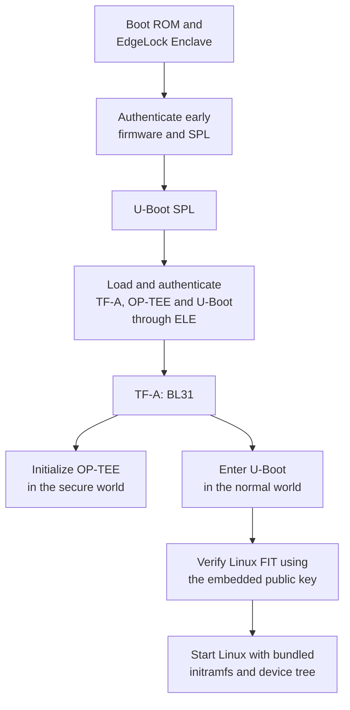
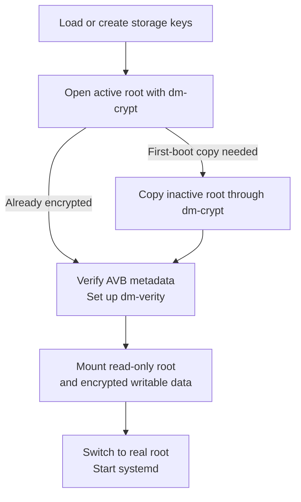

# Security architecture

[Back to README](../README.md)

How boot authentication, root filesystem verification and storage fit together. For build and flashing steps, see [building images](building-images.md) and [device setup](device-setup.md).

## Secure boot authentication

With boot signing enabled and AHAB provisioned for enforcement, the tested boards use this simplified flow:

On i.MX95, OEI initializes DDR and System Manager starts before SPL. On i.MX91 and i.MX93, SPL initializes DDR. See [NXP AN14641, section 3.1](https://www.nxp.com/docs/en/application-note/AN14641.pdf#page=2).

ELE ROM verifies the NXP-signed ELE firmware. ELE firmware handles AHAB authentication of the OEM boot containers, including requests from SPL. See [NXP's AHAB secure boot guide](https://github.com/nxp-imx/uboot-imx/blob/lf_v2026.04/doc/imx/ahab/guides/mx8ulp_9x_secure_boot.txt).

Early firmware and container contents vary by SoC. See [NXP's i.MX9 provisioning guide](https://mcuxpresso.nxp.com/secure/26.03/06_processor_specific_workflow.html#i-mx-9x-device-workflow) for the i.MX93 and i.MX95 image sets.

Optional PQC signing covers the configured AHAB containers.

## Initramfs workflow

First-boot encryption resumes after interruptions. Fatal errors force a reboot.

## Partition layout

The [WIC layout](../files/wic/imx-boot-secure-bootpart.wks.in) writes `imx-boot` before the GPT partitions. Offsets below are measured from the start of the disk and use the default sizes:

| Image / partition | Offset | Default size | Mount point | Purpose |
| --- | --- | --- | --- | --- |
| `fwenv` | 20 KiB | 6 KiB | NA | Firmware environment |
| `fwenv` redundant | 26 KiB | 6 KiB | NA | Firmware environment copy |
| `imx-boot` | 32 KiB (`0x8000`) | Image size | NA | Boot firmware, written raw outside the partition table |
| `imx-boot` redundant | 4 MiB (`0x400000`) | Image size | NA | Second boot image set location with the default secondary boot offset |
| `boot_a` | 8 MiB | 512 MiB | `/boot` | Initial active FIT image |
| `root_a` | 520 MiB | 1024 MiB | `/` | Initial active encrypted and verified root |
| `boot_b` | 1544 MiB | 512 MiB | `/var/boot-update` | Inactive boot slot |
| `root_b` | 2056 MiB | 1024 MiB | Not mounted | Plain root image for first-boot migration, then inactive root slot |
| `secdata` | 3080 MiB | 512 MiB | `/var/secdata` | Key blobs, OP-TEE storage and ELE storage |
| `data` | 3592 MiB | 4096 MiB | `/var/data` | Encrypted persistent storage for writable paths via volatile-binds |

Set partition sizes with the BitBake variables `BOOT_PART_SZ`, `ROOT_PART_SZ`, `SECDATA_PART_SZ` and `DATA_PART_SZ` in `local.conf`.

Mount points above show slot A active. See [OTA update integration](ota-updates.md) for redundant boot images and A/B slot handling.

`secdata` is a plain ext4 filesystem. It holds protected key blobs in `keys/`, OP-TEE storage in `tee/` and ELE persistent storage in `ele/`.

See [AHAB provisioning](ahab-provisioning.md) for device trust anchors and [OTA updates](ota-updates.md) for inactive-slot handling.
