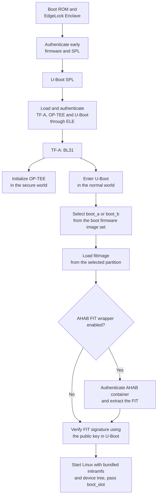
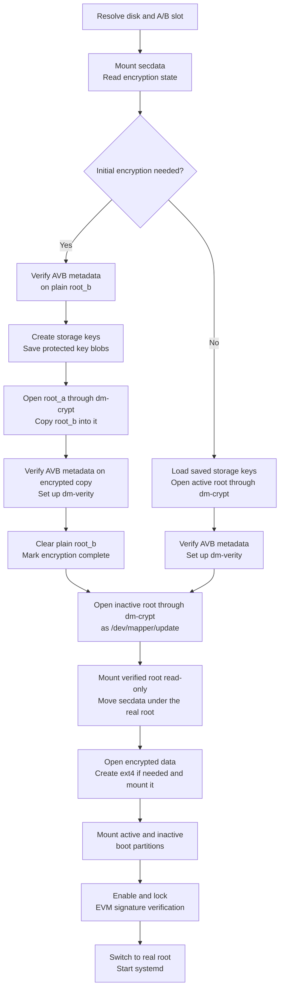

# Boot flow

[Back to README](../README.md)

How the device authenticates boot images and prepares storage before starting systemd. See [partitioning](partitioning.md) for disk offsets and mount points.

## Secure boot authentication

This flow covers the tested i.MX91, i.MX93 and i.MX95 boards with boot signing enabled and AHAB provisioned for enforcement. See [AHAB provisioning](ahab-provisioning.md) for device trust anchors and lifecycle setup.

ELE ROM verifies the NXP-signed ELE firmware. ELE firmware handles AHAB authentication of the OEM containers, including requests from SPL and U-Boot. See [NXP's AHAB secure boot guide](https://github.com/nxp-imx/uboot-imx/blob/lf_v2026.04/doc/imx/ahab/guides/mx8ulp_9x_secure_boot.txt).

Early firmware varies by SoC. On i.MX95, OEI initializes DDR and System Manager starts before SPL. On i.MX91 and i.MX93, SPL initializes DDR. See [NXP AN14641, section 3.1](https://www.nxp.com/docs/en/application-note/AN14641.pdf#page=2).

### FIT authentication

`IMX_FIT_AHAB_ENABLE` defaults to `1` when `IMX_SIGN_ENABLE = "1"` and an `IMX_FIT_AHAB_LOAD_ADDRESS` is configured. The build wraps the signed FIT in an AHAB OS container and deploys it as `fitImage.ahab`. The boot partition stores this file as `fitImage`.

U-Boot runs `auth_cntr` to authenticate the container and place the FIT at the configured address, then runs `bootm` to verify and boot the FIT. If authentication fails or `bootm` returns, this boot command resets the board. With the wrapper disabled, U-Boot boots the FIT directly and still checks its signature when FIT signing is enabled.

Optional PQC signing covers the configured AHAB containers, including the FIT wrapper, on supported silicon. The inner FIT keeps its separate signature.

### A/B slot selection

On supported MMC boots, U-Boot selects `boot_a` for firmware image set 0 or `boot_b` for image set 1. It sets `root=` to the matching root partition and appends `boot_slot=a` or `boot_slot=b` to the kernel command line.

The initramfs uses `root=` to identify the disk and active slot, then selects the matching boot and update partitions. SWUpdate uses `boot_slot=` to select the inactive firmware offset. U-Boot must set both arguments to the same slot. Deploy this initramfs with the U-Boot root selection change. See [OTA update integration](ota-updates.md) for image set selection and update handling.

## Initramfs workflow

The [initramfs scripts](../recipes-core/initrdscripts/imx-secure-initramfs-init/) prepare storage before handing over to the real root filesystem:

### First-boot encryption

The WIC image starts with a populated `boot_a`, an empty `root_a` and the plain root image in `root_b`. Migration must finish in slot A:

1. Verify the AVB metadata signature on `root_b` with the public key in the initramfs.
2. Create an OP-TEE trusted master key and two independent encrypted storage keys: `enc-root` for both root slots and `enc-data` for writable data. Save their protected blobs in `secdata/keys/`.
3. Open `root_a` through dm-crypt and copy all of `root_b` through that mapping, including AVB metadata and verity data.
4. Verify AVB metadata on the decrypted copy and create the read-only dm-verity mapping.
5. Clear the plain source in `root_b` with secure discard, or overwrite it with zeros if secure discard fails. Open it through dm-crypt for future updates.

The `rootfs_crypt` firmware environment value records `prepare`, `copy`, `cleanup` and `done`. An interrupted boot resumes from the saved stage. Once copying can start, retries reuse the saved keys.

### Later boots

The initramfs loads the saved key blobs, opens the selected root through dm-crypt, verifies its AVB metadata and creates `/dev/mapper/verity-root`. It mounts that mapping read-only. dm-verity checks root filesystem blocks as they are read and is configured to restart on corruption.

The inactive root stays available as `/dev/mapper/update`. The encrypted data filesystem is checked and mounted at `/var/data`. Fatal initramfs errors force a reboot.
