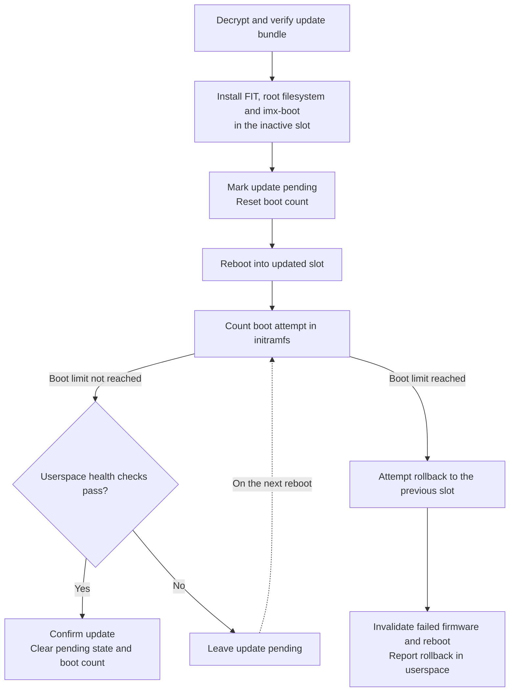

# OTA update integration

[Back to README](../README.md)

Use this guide when adding an update agent. See the [partition layout](architecture.md#partition-layout) for storage sizes and mount points.

The layer provides A/B slot selection and storage mappings. The integrator must handle update delivery, verification, activation, confirmation and recovery. Optional SWUpdate support provides an example implementation with confirmation and rollback helpers.

## Slot layout and boot selection

On supported i.MX8/9 MMC boots, U-Boot selects the FIT partition to match the boot firmware image set:

| Boot image set | Slot | FIT partition | Root partition |
| --- | --- | --- | --- |
| 0 | A | `boot_a` | `root_a` |
| 1 | B | `boot_b` | `root_b` |

U-Boot passes `boot_slot=a` or `boot_slot=b` on the kernel command line. The initramfs uses `root=` to identify the disk and selects the matching root partition. Without `boot_slot=` it keeps the slot identified by `root=`.

An update agent installs the new FIT in `/var/boot-update` and writes the root filesystem image with its AVB metadata and verity data to `/dev/mapper/update`. Both targets belong to the inactive slot. Writes to the inactive rootfs slot are encrypted by dm-crypt.

i.MX ROM selects between redundant boot firmware image sets using container software versions and boot settings. With version-based selection enabled it tries the image set with the higher software version first. Set `SW_VERSION` when building `imx-boot` to assign this version.

Keep each firmware copy aligned with its matching FIT and root filesystem slot. The WIC image writes only the first firmware copy, so the update or provisioning process must populate the second copy. See [Partition layout](architecture.md#partition-layout) for the default locations.

See [build artifacts](building-images.md#build-artifacts) for the files produced by the build.

## SWUpdate example implementation

> **WARNING:** This example is a proposal and is not production-ready. The integrator must adapt and validate it for the product's update and recovery workflow.

Optional SWUpdate support provides CMS-signed, AES-encrypted `.swu` bundles through `imx-secure-image-base-update`. Install a bundle with `swupdate-client /path/to/imx-secure-image-base-update.swu`.

The example counts boot attempts in initramfs and confirms updates after userspace health checks. Rollback needs a remaining fallback firmware copy. Development updates invalidate the old copy to allow reused software versions. Production updates keep it for fallback.

### Example SWUpdate workflow

### Example limitations

Power loss or ROM fallback can cause slot-mismatch reboot loops. Failures before initramfs are not counted, and failed health checks leave the update pending without retrying or rebooting. Use a strictly higher `SW_VERSION` for production bundles, including prod-to-prod updates. Validate interrupted updates and recovery on the target hardware.
