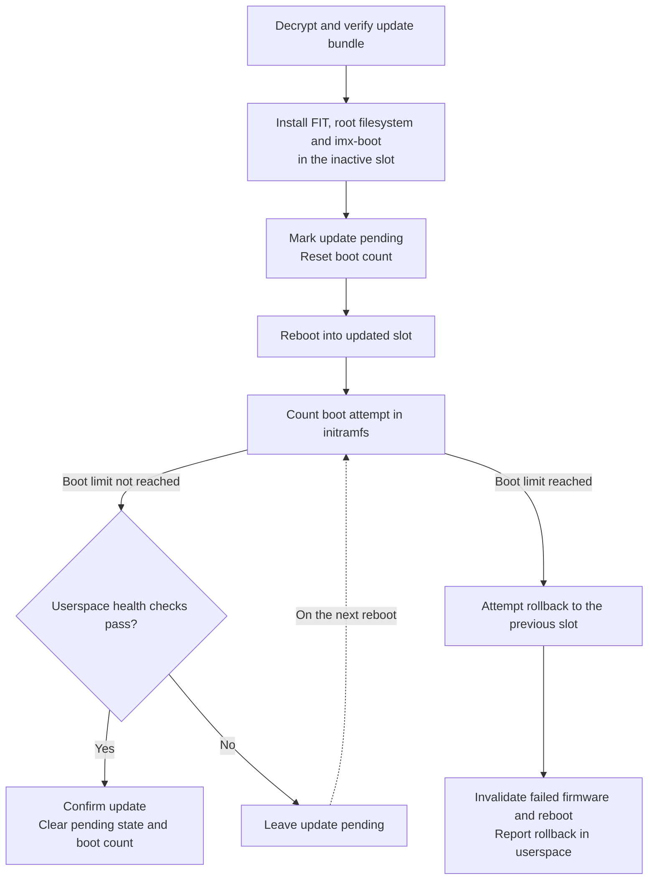

# OTA update integration

[Back to README](../README.md)

Use this guide when adding an update agent. See the [partition layout](architecture.md#partition-layout) for storage sizes and mount points.

The layer provides A/B boot and root filesystem slot selection. On supported i.MX8/9 MMC boots, U-Boot selects the FIT partition to match the boot firmware image set:

| Boot image set | Slot | FIT partition | Root partition |
| --- | --- | --- | --- |
| 0 | A | `boot_a` | `root_a` |
| 1 | B | `boot_b` | `root_b` |

U-Boot passes `boot_slot=a` or `boot_slot=b` on the kernel command line. The initramfs uses `root=` to identify the disk and selects the matching root partition. Without `boot_slot=` it keeps the slot identified by `root=`.

An update agent installs the new FIT in `/var/boot-update` and writes the root filesystem image with its AVB metadata and verity data to `/dev/mapper/update`. Both targets belong to the inactive slot. Writes to the inactive rootfs slot are encrypted by dm-crypt.

The update agent must manage update verification, slot activation, boot-success confirmation and rollback. The layer provides the boot flow and storage mappings but does not include a complete OTA agent.

## Boot firmware selection

i.MX ROM selects between redundant boot firmware image sets using container software versions and boot settings. With version-based selection enabled it tries the image set with the higher software version first. Set `SW_VERSION` when building `imx-boot` to assign this version.

Keep each firmware copy aligned with its matching FIT and root filesystem slot. The WIC image writes only the first firmware copy, so the update or provisioning process must populate the second copy. See [Partition layout](architecture.md#partition-layout) for the default locations.

See [build artifacts](building-images.md#build-artifacts) for the files produced by the build.

Optional SWUpdate support provides CMS-signed, AES-encrypted `.swu` bundles through `imx-secure-image-base-update`. Install a bundle with `swupdate-client /path/to/imx-secure-image-base-update.swu`.

> **WARNING:** Do not test a *dev* to *prod* SWUpdate transition with the same `SW_VERSION`. Production bundles keep the old firmware copy because ROM may boot the old slot and trigger a slot-mismatch reboot loop. Use a strictly higher firmware version.

## OTA update workflow

Rollback needs a remaining fallback firmware copy. Development updates invalidate the old copy to allow reused software versions. Production updates keep it for fallback.
